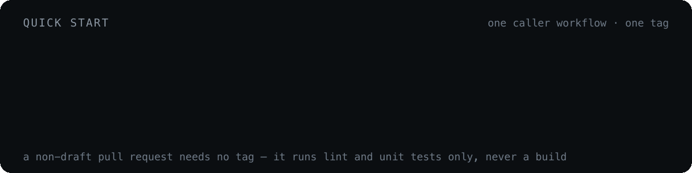

# Quick start

<p align="center">
  
</p>

**1. Add the caller workflow** to the product repository as `.github/workflows/ci-build-trigger.yaml`. Three jobs: find a self-hosted runner, create one if none is free, then hand the original event to the switcher.

```yaml
  ci-build-trigger-switcher:
    name: CI Build Trigger Switcher
    uses: novaitdevteam/nova.ci/.github/workflows/ci-build-trigger-switcher.yaml@main
    secrets: inherit
    if: always()
    needs: [find-runner, create-runner]
    with:
      runner_labels: ${{ (needs.find-runner.outputs.runner_need != 'true' || needs.create-runner.result == 'success') && needs.find-runner.outputs.runner_labels || '' }}
```

The `runner_labels` expression is the fallback chain: a Hetzner runner when one is reused, created or being waited for at the cap; the in-cluster `self-hosted` pool only when `find-runner` failed or the VM it asked for was not created. Without the `create-runner.result` check, a failed create still passed the size label, and the build queued for a VM that never came, until GitHub's timeout. Keep the `&& … || ''` order: `cond && '' || x` always yields `x`, because an empty string is false.

<details>
<summary>Full caller workflow</summary>

```yaml
name: CI Build Trigger
on:
  workflow_dispatch:
  push:
  pull_request:

jobs:
  find-runner:
    name: Check available runners
    env:
      GH_TOKEN: ${{ secrets.PERSONAL_ACCESS_TOKEN }}
      ORG: ${{ github.repository_owner }}
      HCLOUD_TOKEN: ${{ secrets.HCLOUD_TOKEN }}
    runs-on: ci-bootstrap
    outputs:
      runner_name: ${{ steps.check.outputs.runner_name }}
      runner_labels: ${{ steps.check.outputs.runner_labels }}
      runner_size: ${{ steps.check.outputs.runner_size }}
      runner_need: ${{ steps.check.outputs.runner_need }}
    steps:
      - name: Install script
        run: curl -O https://raw.githubusercontent.com/novaitdevteam/nova.ci/refs/heads/main/.github/workflows/ci-build-create-runner.sh
      - name: Check runners
        id: check
        run: |
          chmod +x ci-build-create-runner.sh
          ./ci-build-create-runner.sh

  create-runner:
    name: Create Hetzner Cloud runner
    if: ${{ needs.find-runner.outputs.runner_need == 'true' }}
    runs-on: ci-bootstrap
    needs: [find-runner]
    steps:
      - uses: novaitdevteam/nova.ci.hcloud-github-runner@main
        with:
          mode: create
          github_token: ${{ secrets.PERSONAL_ACCESS_TOKEN }}
          hcloud_token: ${{ secrets.HCLOUD_TOKEN }}
          server_type: ${{ needs.find-runner.outputs.runner_size }}
          location: fsn1
          org: novaitdevteam
          name: ${{ needs.find-runner.outputs.runner_name }}
          labels: ${{ needs.find-runner.outputs.runner_labels }}

  ci-build-trigger-switcher:
    name: CI Build Trigger Switcher
    uses: novaitdevteam/nova.ci/.github/workflows/ci-build-trigger-switcher.yaml@main
    secrets: inherit
    if: always()
    needs: [find-runner, create-runner]
    with:
      runner_labels: ${{ (needs.find-runner.outputs.runner_need != 'true' || needs.create-runner.result == 'success') && needs.find-runner.outputs.runner_labels || '' }}
```

</details>

Runner selection lives in [`ci-build-create-runner.sh`](../../.github/workflows/ci-build-create-runner.sh), downloaded from `main` — see [Runners](../pipeline/runners.md).

The caller reads `PERSONAL_ACCESS_TOKEN` and `HCLOUD_TOKEN`; the build reads `CR_DH_USERNAME` / `CR_DH_TOKEN` for Docker Hub and the notifiers `TG_NOTIFICATION_BOT_ID` / `TG_NOTIFICATION_BOT_TOKEN` / `GC_NOTIFICATION_WEBHOOK`. Check they exist on the repository (`gh secret list`) before the first run: a missing one arrives as an empty string, not an error.

<details>
<summary>A new repository: the nova.ci side comes first</summary>

The caller alone does nothing for a repository nova.ci does not know: every switcher job is gated on a repository list, so the first run reports a green bootstrap and skips everything else. Land the nova.ci change **before** the caller, so the caller's first pull request is the first live run. `novatalks.rag` (NC2-3092, nova.ci#98) is the worked example. The nova.ci change touches:

- [`ci-build-trigger-switcher.yaml`](../../.github/workflows/ci-build-trigger-switcher.yaml): the three scan lists (`secret-scan`, `sast-scan`, `deps-scan` — identical, keep them so), the tag build route and the pull request build route.
- [`ci-build-ntk-on-push-tags-build.yaml`](../../.github/workflows/ci-build-ntk-on-push-tags-build.yaml): a lint arm and a unit arm in the two `Resolve … plan` steps (none means `⏭️ n/a`, never a fake `✅`), and a `Set Dockerfile path` arm if the repository has no `docker/server.Dockerfile`. Run the repository's own lint and test scripts locally first.
- The repository counts and lists in `docs/`, `.claude/rules/`, the `nova-ci` skill and its mirror, and `scripts/gitleaks-baseline.sh`.

Trivy and Semgrep need nothing more. DAST does: a repository joins it only on request, through its own `targets.sh` arm read from its code — see the `dast-target-wiring` skill.

</details>

**2. Trigger something:**

| I want to… | Do this |
| --- | --- |
| Build and publish an image | `git tag build-NC2-1234 && git push origin build-NC2-1234` |
| Build one image of a multi-image repository | `novatalks.core`: `build-engine`, `build-reporting`, … ([Dockerfile selection](../pipeline/build-pipeline.md#dockerfile-selection)); `novatalks.rag`: `build-<process>[-NC2-1234]`, one tag per process in its `docker/` |
| Build **and** scan the image for CVEs | `git tag scan-NC2-1234 && git push origin scan-NC2-1234` |
| Run unit tests only | `git tag unit-test-NC2-1234 && git push …` |
| Run integration tests only | `git tag int-test-NC2-1234 && git push …` |
| Run both suites | `git tag full-test-NC2-1234 && git push …` |
| Lint + unit tests on a change | Open a pull request — drafts included |

Trigger tags are consumed: the workflow deletes them after the run. Test tags (`unit-test`, `int-test`, `full-test`) are routed for `novatalks.core` only.

**3. Keep routing centralized.** Build dispatch belongs in [`ci-build-trigger-switcher.yaml`](../../.github/workflows/ci-build-trigger-switcher.yaml), not in the local caller. The caller may receive PR-related events the switcher does not route; only matched switcher jobs do shared CI work.

---

[← Docs index](../README.md) · [How a trigger is routed →](../pipeline/routing.md)
